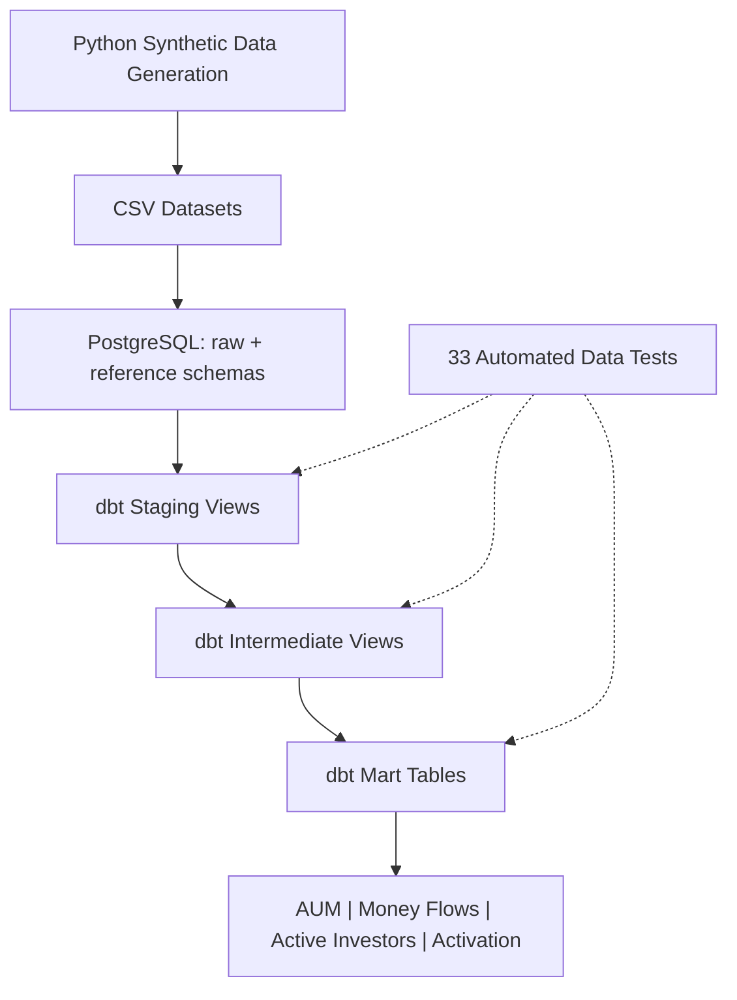

# Financial Analytics Platform

**Analytics Engineering | Wealth Management | PostgreSQL · dbt · Python**

A modular financial analytics platform that transforms simulated wealth-management operational data into governed, analytics-ready datasets and standardized business metrics.

The solution covers source-data generation, relational ingestion, SQL-based transformation, financial KPI modelling and automated data-quality validation. PostgreSQL provides the analytical storage and execution layer, while dbt manages transformation dependencies, materializations, testing and documentation.

## 1. Architecture

```text
Source Simulation (Python)
        │
        ▼
Relational Data Generation
        │
        ▼
PostgreSQL
├── raw
│   ├── customers
│   ├── accounts
│   ├── transactions
│   ├── portfolio_snapshots
│   ├── customer_events
│   └── market_prices
│
└── reference
    ├── products
    ├── portfolios
    ├── instruments
    └── portfolio_holdings
        │
        ▼
dbt Transformation Layer
├── Staging        Source standardization and type enforcement
├── Intermediate   Reusable financial and customer business logic
└── Marts          Business-facing analytical datasets
        │
        ▼
Data Quality & Reconciliation
        │
        ▼
Analytics Consumption
```

The current implementation operates in a local PostgreSQL development environment. Analytics consumption is supported through SQL-accessible mart tables; a dedicated BI deployment is not part of the current release.

## 2. Technology Stack



| Layer | Implementation |
|---|---|
| Data generation | Python, pandas, NumPy, Faker |
| Data ingestion | pandas, SQLAlchemy, psycopg2 |
| Analytical database | PostgreSQL |
| Transformation framework | dbt Core, dbt-postgres |
| Business logic | PostgreSQL SQL, CTEs, conditional aggregation, window functions |
| Data quality | dbt generic tests, custom SQL assertions |
| Configuration | Environment variables, dbt profiles |
| Version control | Git |

## 3. Source Data Model

The platform represents a European digital wealth-management business with customer onboarding, investment accounts, cash movements, portfolio allocation and periodic portfolio valuations.

The synthetic dataset contains:

| Entity | Records |
|---|---:|
| Customers | 2,000 |
| Investment accounts | 2,077 |
| Financial transactions | 20,000 |
| Portfolio valuation snapshots | 168,654 |
| Customer events | 40,000 |
| Market-price observations | 28,050 |
| Investment products | 5 |
| Portfolios | 10 |
| Financial instruments | 30 |
| Portfolio holdings | 108 |

Relationships are defined around customer, account, transaction, portfolio and instrument identifiers. Generation follows entity dependencies to maintain consistent references between parent and child records.

Source-level validation covers identifier uniqueness, referential integrity, date constraints, nonnegative financial values and portfolio allocation consistency.

Portfolio snapshots are generated at approximately weekly intervals.

## 4. Transformation Architecture

Transformation logic is organized into three dbt modelling layers.

### Staging

Staging models provide standardized representations of operational source tables.

Responsibilities include:

- Explicit conversion of source timestamps and dates into PostgreSQL types
- Standardization of categorical values and currency codes
- Conversion of financial amounts to decimal numeric representations
- Preservation of source identifiers and transaction-level records

Staging models are materialized as PostgreSQL views.

### Intermediate

Intermediate models implement reusable business rules independently of reporting aggregation.

Implemented transformations include:

| Model | Responsibility |
|---|---|
| `int_money_flows` | Eligible completed deposits and withdrawals, with signed cash-flow amounts |
| `int_monthly_account_valuations` | Latest available portfolio valuation per account and reporting month |
| `int_customer_activation` | First completed customer deposit and 30-day activation flag |
| `int_customer_segments` | Customer segmentation by investment-risk profile |

Intermediate models are materialized as views.

### Analytical Marts

Mart models expose defined analytical grains and business metrics.

| Model | Grain | Purpose |
|---|---|---|
| `fct_monthly_money_flows` | Reporting month | Gross deposits, gross withdrawals and net flows |
| `fct_monthly_aum` | Reporting month | Assets under management and account valuation counts |
| `fct_monthly_active_investors` | Reporting month | Distinct active investors, eligible accounts and associated AUM |
| `fct_monthly_customer_activation` | Registration month | Thirty-day activation counts and rates |
| `mart_customer_summary` | Risk segment | Customer distribution by risk category |

Mart models are materialized as PostgreSQL tables.

Model dependencies are declared through dbt `source()` and `ref()` references. dbt resolves the dependency graph and determines build order.

## 5. Metric Definitions

### Net Money Flows

**Net Flows = Gross Deposits − Gross Withdrawals**

Only completed deposit and withdrawal transactions are included.

Failed, cancelled and reversed transactions are excluded. Fees and transfers are outside the scope of this customer net-flow definition.

The current implementation recognizes transactions using `transaction_ts`. Settlement-date recognition has not been implemented.

### Assets Under Management (AUM)

AUM is calculated by summing each account's latest available market valuation within the reporting month.

The intermediate model uses `ROW_NUMBER()` partitioned by account and reporting month to select a single valuation record.

This represents the latest available in-month valuation, which may differ from a formal month-end valuation when observations are not available on the reporting date.

### Active Investors

An active investor is a distinct customer with at least one positive-value investment account that was open on its selected valuation date.

Historical eligibility is evaluated using account opening and closing timestamps instead of relying exclusively on current account status.

A customer with multiple eligible accounts is counted once.

### Customer Activation

A customer is activated within 30 days when their first completed deposit occurs between registration and 30 days after registration.

The monthly activation rate uses registration cohorts:

**30-Day Activation Rate = Activated Eligible Customers / Eligible Customers × 100**

Only registrations with a complete 30-day observation window contribute to the rate denominator.

The present implementation uses the maximum available transaction timestamp as a provisional observation cutoff.

## 6. Data Quality and Reconciliation

The transformation layer implements both generic dbt tests and custom SQL assertions.

| Control area | Validation |
|---|---|
| Source integrity | Non-null and unique identifiers |
| Model grain | Unique reporting periods and account-month records |
| Metric completeness | Required financial outputs are non-null |
| Net-flow reconciliation | Net flows equal deposits less withdrawals |
| AUM reconciliation | Reported monthly AUM agrees with underlying selected valuations |
| Financial validity | Nonnegative AUM and consistent account counts |
| Investor consistency | Eligible account counts are not lower than distinct investor counts |
| Activation consistency | Numerator, denominator and published activation rates satisfy defined constraints |

Custom SQL tests identify records violating expected business rules. A test passes when its query returns no violating records.

## 7. Execution

### Prerequisites

- Python 3.12 and PostgreSQL
- A PostgreSQL database named `financial_analytics`
- A database user with permissions to create and populate tables in the `raw`, `reference` and dbt target schemas
- Python dependencies from `requirements.txt`
- A local `.env` file based on `.env.example`
- A dbt PostgreSQL profile configured with the project database credentials

### Environment Setup

From the repository root:

```bash
python -m venv .venv
source .venv/bin/activate
pip install -r requirements.txt
cp .env.example .env
```

Edit `.env` to supply the PostgreSQL connection settings and password. Do not commit this file.

Load the configuration into the shell:

```bash
set -a
source .env
set +a
```
### dbt Profile Setup

dbt uses a connection profile to access PostgreSQL. A reusable
profile template is provided in `dbt/profiles.yml.example`.

For a new installation, create the dbt configuration directory:

```bash
mkdir -p ~/.dbt
```

Then copy the supplied profile:

```bash
cp dbt/profiles.yml.example ~/.dbt/profiles.yml
```

The profile reads database credentials from environment variables.
If an existing `~/.dbt/profiles.yml` is present, review it before
replacing it.

### Synthetic Data Generation

From the repository root:

```bash
python -m src.generation.generate_data
```

This generates synthetic wealth-management datasets under `data/`, including customers, accounts, transactions, portfolio valuations and supporting reference data.

### PostgreSQL Ingestion

With the database running and the necessary schemas and permissions configured, execute from the repository root:

```bash
python -m src.ingest_data
```

The ingestion workflow loads the generated CSV files into PostgreSQL.

**Important:** The current ingestion strategy replaces destination tables. Running it against an existing database may overwrite data. Use a dedicated local development database.

### dbt Transformation and Validation

From the repository root, with the environment variables loaded:

```bash
cd dbt
dbt debug
dbt build
dbt docs generate
```

For targeted development:

```bash
dbt build --select +fct_monthly_money_flows
dbt test --select fct_monthly_aum
```

The `+` selector includes upstream dependencies. `dbt build` executes models and applicable tests in dependency order.

### Validation Baseline

The complete local dbt build passed 46 operations on 1 November 2026: 5 table models, 8 view models and 33 data tests, with zero errors and zero warnings.

Database credentials remain in local configuration and are excluded from version control.


## 8. Engineering Considerations

**Ingestion strategy:** The current Python ingestion workflow uses full-refresh table replacement. Production deployment would require controlled schema management and an incremental or otherwise non-destructive loading strategy.

**Temporal coverage:** Portfolio valuations and transactions do not have identical observation end dates. KPI comparisons across sources therefore require explicit period alignment.

**Financial precision:** Monetary source fields are ingested as floating-point values and converted to PostgreSQL numeric representations in staging. Production financial pipelines should preserve decimal precision at the source and ingestion layers.

**Valuation freshness:** AUM uses the latest available in-month snapshot without a cross-period carry-forward policy or staleness threshold.

**Risk segmentation:** Five source risk profiles are grouped into three analytical segments. The grouping is a reporting convention and is not a regulatory suitability classification.

**Operational scope:** Automated scheduling, production monitoring, CI/CD enforcement and dedicated BI deployment are outside the currently implemented platform.

## 9. Repository Organization

```text
financial-analytics-platform/
├── src/
│   ├── generation/
│   └── ingest_data.py
├── dbt/
│   ├── models/
│   │   ├── staging/
│   │   ├── intermediate/
│   │   └── marts/
│   ├── tests/
│   └── dbt_project.yml
├── data/
│   ├── raw/
│   └── reference/
├── docs/
├── environment.yml
├── requirements.txt
└── README.md
```

Operational source data is synthetic. Runtime artifacts, generated raw CSV datasets and credentials are excluded from the repository.

---

**Project status:** Core financial transformation and KPI models implemented and tested in a local development environment. Production orchestration and downstream BI deployment are not included.